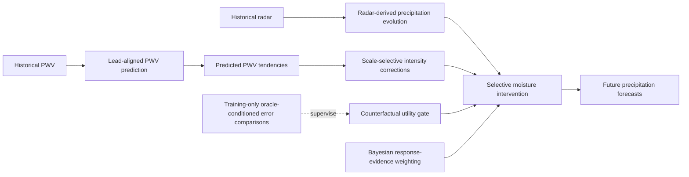

# PCMI-Net

**Physics-Guided Counterfactual Moisture Intervention for Extreme Precipitation Nowcasting**

PCMI-Net is a radar-and-moisture framework for short-term precipitation forecasting. Rather than fusing precipitable water vapor (PWV) indiscriminately with radar features, it treats PWV as a **selective correction signal** for precipitation intensity changes that cannot be fully inferred from radar history.

> **Repository status:** This README summarizes the proposed method and the experimental results currently reported in the manuscript. Source-code structure, environment specifications, dataset access instructions, and executable commands will be documented when those materials are available.

## Motivation

Extreme precipitation nowcasting is challenging because rainfall intensity can grow or decay rapidly, even when precipitation motion is relatively predictable. Historical radar observations characterize existing precipitation structures and their evolution, while PWV provides complementary information about the atmospheric moisture environment.

PCMI-Net addresses three related questions:

1. **When** is PWV likely to add predictive value beyond radar history?
2. **How** should PWV guide corrections to the predicted precipitation evolution?
3. **How strongly** should the model rely on a PWV-conditioned correction when its precipitation response is uncertain?

## Method Overview

### 1. Radar-derived precipitation evolution

A radar evolution pathway models precipitation transport and intensity changes inferable from historical radar observations. It uses the evolution network of **NowcastNet** as a component; this dependency is acknowledged rather than presented as a new architecture.

### 2. Scale-selective moisture correction

PCMI-Net predicts lead-aligned PWV, extracts its temporal tendencies, and uses them to guide corrections to precipitation growth and decay that radar history may not fully capture. The corrections are applied selectively across spatial scales rather than treating PWV as a uniformly useful input.

### 3. Counterfactual utility learning

A counterfactual utility gate learns **where and when** moisture-conditioned corrections are likely to help. During training, oracle-conditioned error comparisons provide supervision; inference does **not** require future precipitation observations or oracle targets.

### 4. Bayesian response-evidence weighting

A Bayesian response-evidence mechanism regulates candidate moisture corrections according to uncertainty propagated into **precipitation-response space**. This uncertainty should not be confused with a direct measurement of PWV sensor quality. Neither the counterfactual gate nor the Bayesian weight is claimed to be a calibrated probability that a forecast will improve.

## Physics-Guided Motivation

The advection equation with a source/sink term distinguishes precipitation transport from non-advective intensity changes:

$$
\frac{\partial R}{\partial t} + (\mathbf{v}\cdot\nabla)R = S_R,
$$

where $R$ is precipitation intensity, $\mathbf{v}$ represents precipitation motion, and $S_R$ describes intensity evolution beyond advection.

The vertically integrated moisture budget links precipitation to evolving atmospheric water vapor:

$$
\frac{\partial W}{\partial t} = E - \mathcal{P} - \nabla\cdot\mathbf{Q},
$$

where $W$ denotes PWV, $E$ evaporation, $\mathcal{P}$ precipitation rate, and $\mathbf{Q}$ vertically integrated moisture flux.

Together, these relationships motivate using PWV evolution as **additional information** about precipitation intensity changes. They do **not** imply that PWV uniquely determines the precipitation source/sink term or that the physical source/sink can be uniquely divided into radar and PWV processes. PCMI-Net therefore learns a conditional forecast correction, not an explicit numerical solution of the coupled physical equations.

## Datasets and Evaluation

The manuscript evaluates PCMI-Net on:

- **CONUS:** Contiguous United States precipitation nowcasting data.
- **MRB:** Mississippi River Basin data, including an extreme-event evaluation.

The evaluation focuses on high-intensity precipitation. For the reported **MRB extreme-event evaluation**, the CSI-64 result is:

| Metric | Strongest reported comparator | PCMI-Net |
|:--|--:|--:|
| CSI-64 | 0.1658 | **0.2172** |

These are the results reported in the manuscript; they are not newly reproduced by this repository document. Dataset versions, exact splits, lead times, preprocessing, and evaluation scripts must be specified before a full independent reproduction is possible.

## Installation and Usage

The exact repository structure and runnable commands have not yet been provided. To avoid misleading examples, this README does not invent file paths, package versions, or training flags.

A reproducible release should document:

- Environment and dependency versions.
- Radar and PWV dataset preparation and temporal alignment.
- Training configurations and counterfactual supervision setup.
- Inference and evaluation commands.
- Checkpoint availability and expected outputs.

## Citation and Attribution

If you build on PCMI-Net, please cite its associated paper once bibliographic details are available. A ready-to-copy BibTeX entry can be added after the paper title, author list, and publication/preprint information are finalized.

The radar evolution component builds on **NowcastNet**:

> Zhang et al., *Skilful nowcasting of extreme precipitation with NowcastNet*, Nature (2023).

Please also follow the original NowcastNet repository's licensing and attribution requirements for any reused code or weights.

## License

A license has not yet been specified for PCMI-Net. Refer to the repository's `LICENSE` file once one is added; do not assume a license for the code or datasets.
